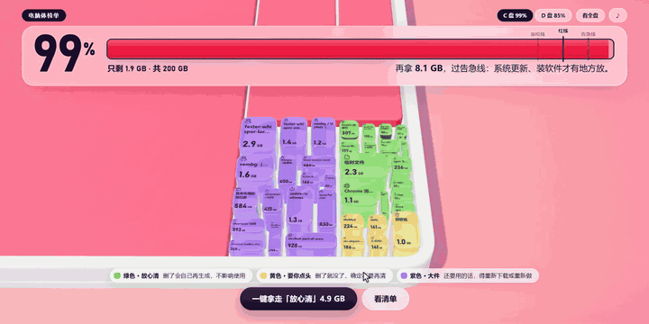
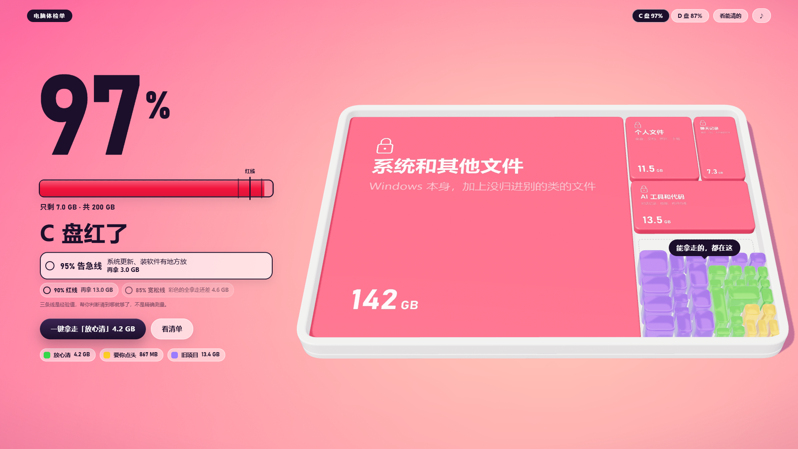
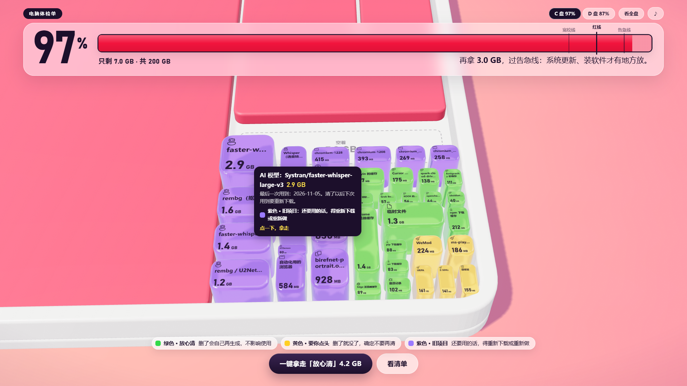
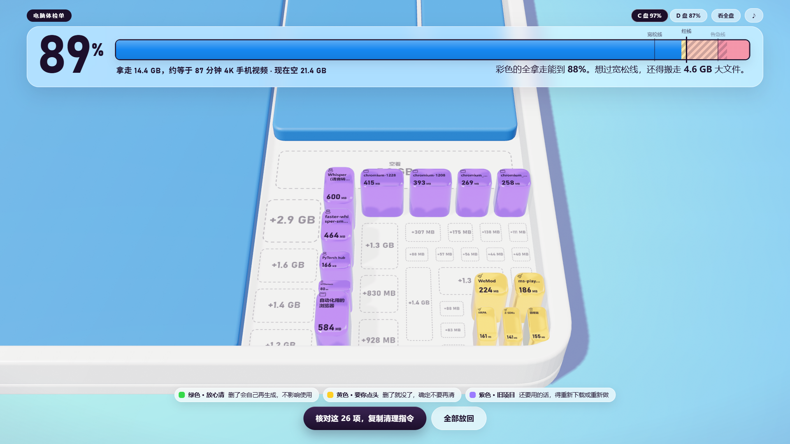
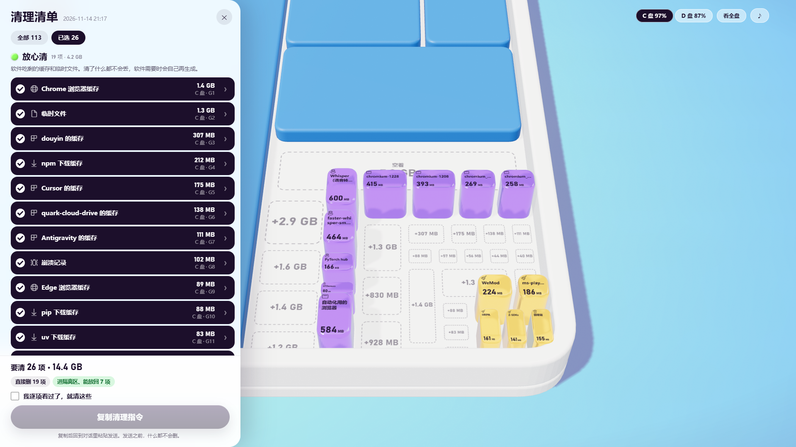

# pc-checkup 电脑体检单

给 Windows 和 Mac 清磁盘，谁都能用。说一句"扫描我的电脑"，它只看不删，然后弹出一张能点的体检单：整个盘是一个盒子，能清的是彩色果冻块。





这是真实机器上的结果。系统盘快满了，Windows 里那根条已经红了。盒子里带锁的大块是系统、个人文件、聊天记录，体检不碰。彩色的才是能拿走的。



镜头推近以后，每一块印着名字和大小。指上去会说它是什么、删了会怎样。底下一排是三种颜色的意思：

- 绿色，放心清。浏览器缓存、临时文件这类，删了会自己再生成。
- 黄色，要你点头。安装包、回收站 / 废纸篓这类，删了就没了。
- 紫色，大件。AI 模型、旧版浏览器内核、渲染帧、旧依赖包，还要用得重新下载。



点一块，它弹起来飞走，原地留一个"+2.9 GB"的印子，点印子能放回来。进度条上有三条线，过一条说一句换来了什么。过了 90% 那条红线，整个画面从红翻成蓝。



最后一关。要清哪些，一项一项列出来，哪些直接删、哪些先进隔离区能放回，写在下面。勾上"我逐项看过了"，才能复制清理指令。把指令粘回对话，它才动手，而且只清指令里那几项。

## 它和"一键清理"有什么不一样

清理软件的毛病是你不知道它删了什么。这个 skill 只认一条：

> 先看，再让人确认，最后才删。没确认的一个字节都不动。

所以：

- 扫描是只读的。系统目录、个人资料、聊天记录、游戏和应用本体，写死了不碰。
- 普通清理软件不认识的大件单独找：重复下载的模型、旧版无头浏览器、渲染帧、旧项目的 `node_modules` 和虚拟环境。玩 AI、写代码、做视频的人，磁盘多半是被这些撑满的。
- 拿不准的不直接删，先移到隔离区，后悔了能放回去。
- 体检单是固定模板，脚本把数据填进去。模型不用写一行网页，换个弱一点的模型也是同一张单子。
- Windows 和 macOS 各有一套脚本，出的是同一份报告格式、同一张体检单。

## 怎么用

在豆包里：切到"豆包工作"，选这个技能，发两句话。

第一句：

```
扫描我的电脑，找出临时文件、软件缓存、旧安装包、回收站文件以及卸载残留，禁止触碰系统、个人资料和游戏目录，最后列出一个清理清单
```

浏览器会弹出体检单。在上面点要清的，核对，复制指令。

第二句，把复制的指令粘回去，长这样：

```
按清单清理：G1 G2 G3 Y2
体检单编号：20261114-211759
```

装进 `~/.claude/skills/` 给 Claude 用也一样，说"电脑体检""磁盘满了"就行。

要的东西：

- Windows 10 / 11：自带的 PowerShell 5.1。
- macOS：`bash` + `python3`（系统自带或 Homebrew）。

不联网，不装别的。

## 里面有什么

| 文件 | 干什么 |
|---|---|
| `SKILL.md` | 入口：两步流程、按系统选命令、不许做什么 |
| `scripts/scan.ps1` / `scan.sh` | 只读扫描，出一份报告，然后自动生成并打开体检单 |
| `scripts/report.ps1` / `report.sh` | 把报告数据填进模板，生成 `report-<编号>.html` |
| `scripts/clean.ps1` / `clean.sh` | 按指令里的编号清理，其余不动 |
| `scripts/common.ps1` / `common.sh` | 公用函数和保护规则 |
| `scripts/protected-names.txt` | Windows 上不碰的目录名单 |
| `assets/report-template.html` | 体检单模板，单个文件，three.js 已经打包在里面 |
| `references/rules.md` | 每一类东西能不能删、为什么 |
| `references/settings.md` | 系统设置方面的建议，用户问了才给 |

## 现在的状态

- Windows 扫描和体检单在作者电脑上跑通了。
- macOS 脚本按同一份报告格式写好了，覆盖常见缓存、废纸篓、模型、依赖；家目录深扫默认有深度限制。还没在真机上长跑验证。
- 豆包"本地电脑"模式能不能跑这些脚本、能不能自动弹浏览器，还没实测。
- 进度条上 90% 那条线是 Windows 变红的真实规则。95% 和 85% 两条是经验值，体检单上也是这么写的；Mac 上同样按占用比例显示。
- 彩色那一角占整个盘的比例是真的。角里面的小块放大过，不然点不到，看大小以块上印的数字为准。

## 许可

MIT，见 [LICENSE](LICENSE)。随便用、随便改；清理前请先看清单，作者不对误删负责。
